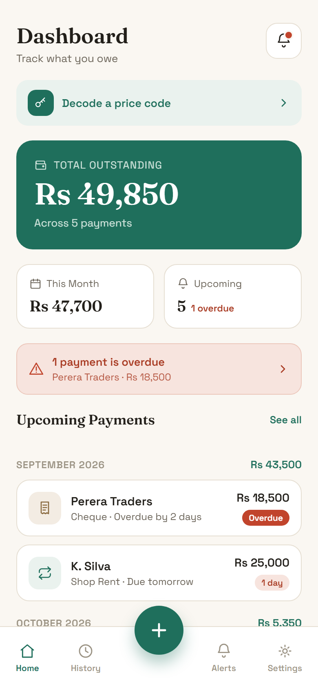
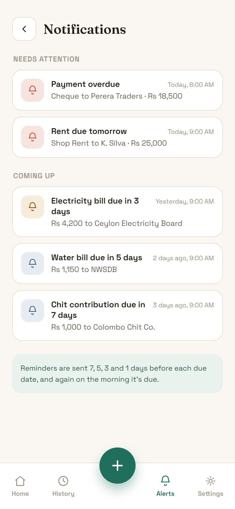
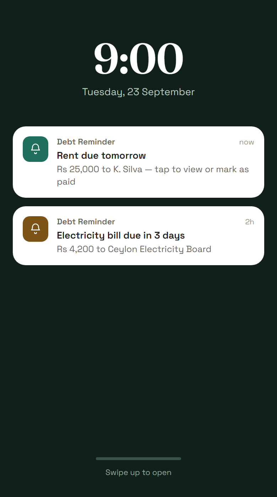
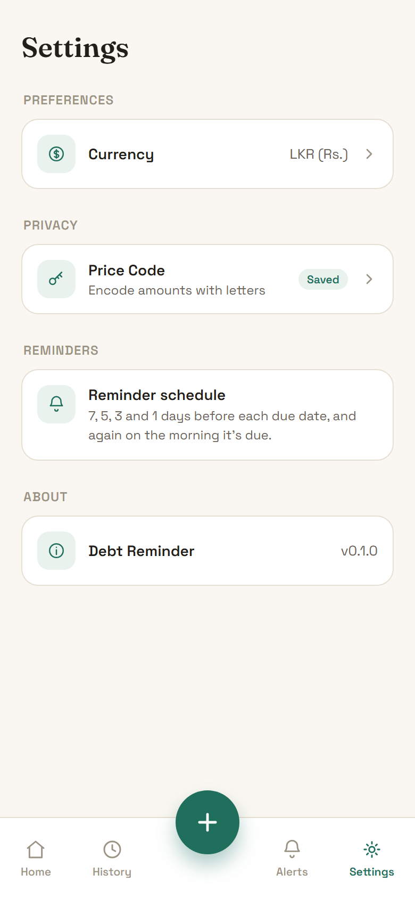
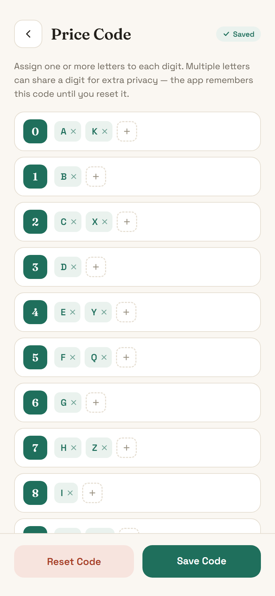
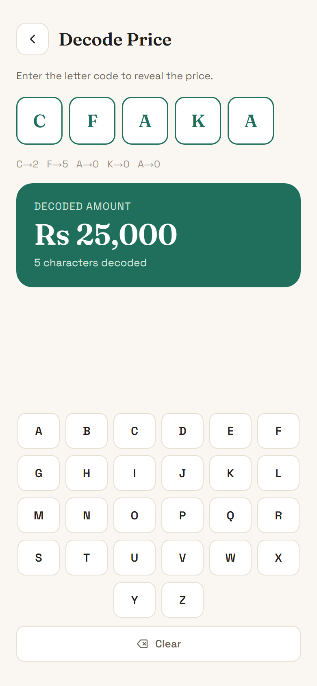

# TR Ledger — Debt Reminder

A local-only debt and bill reminder app built with Flutter for TR Clothings. It keeps track of what you owe and when it's due, and reminds you before each payment. All data stays on the device: no account, no server, no sync.

## Screenshots

> These are renders of the app's UI design mockups, so the sample data is illustrative.

<table>
  <tr>
    <td align="center"><br><sub>Dashboard</sub></td>
    <td align="center"><br><sub>Notifications</sub></td>
    <td align="center"><br><sub>Reminder notification</sub></td>
  </tr>
  <tr>
    <td align="center"><br><sub>Settings</sub></td>
    <td align="center"><br><sub>Price code setup</sub></td>
    <td align="center"><br><sub>Price code decoder</sub></td>
  </tr>
</table>

## Features

- **One-time debts:** record a single payment with an amount and due date.
- **Recurring debts:** bills that repeat daily, on a fixed day each month, or every N days. When you mark a cycle paid, the next one is generated from the *expected* due date, so paying late never shifts the schedule. You can also change the amount for just the current cycle (for example, this month's electricity bill).
- **Reminders:** local notifications at 9:00 AM, 7, 5, 3 and 1 day(s) before each due date. They are cancelled automatically when a debt is paid early, edited or deleted.
- **Dashboard:** summary cards, an overdue banner, and upcoming debts grouped by month.
- **History:** a list of paid debts.
- **Price code decoder:** set up a letter-to-digit code (several letters can map to one digit) and decode letter price tags back into amounts.
- **Settings:** choose a currency (LKR by default; INR, USD, GBP and EUR are also available).

## Tech stack

| Concern | Library |
| --- | --- |
| State management | [flutter_riverpod](https://pub.dev/packages/flutter_riverpod) |
| Local database | [drift](https://pub.dev/packages/drift) (SQLite) |
| Notifications | [flutter_local_notifications](https://pub.dev/packages/flutter_local_notifications) + [timezone](https://pub.dev/packages/timezone) |
| Routing | [go_router](https://pub.dev/packages/go_router) |
| Formatting | [intl](https://pub.dev/packages/intl) |

## Project structure

```
lib/
├── core/          # enums, constants, theming, date/recurrence utilities
├── data/          # drift database & tables, repositories, notification service, providers
├── domain/        # plain models (debts, occurrences, dashboard items)
└── presentation/  # screens and controllers, one folder per feature
```

## Getting started

Requirements: Flutter with Dart SDK `^3.6.0`.

```bash
flutter pub get
dart run build_runner build --delete-conflicting-outputs   # regenerate drift code after schema changes
flutter run
```

Run the tests:

```bash
flutter test
```
